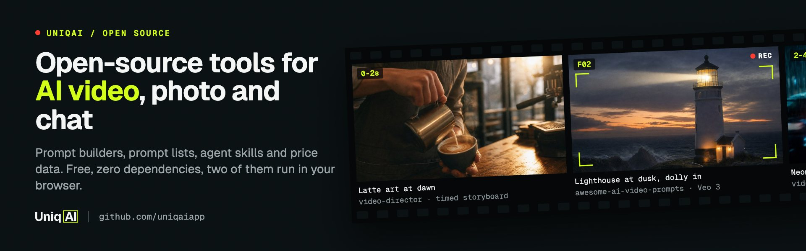

<div align="center">

<picture>
  <source media="(prefers-color-scheme: dark)" srcset="https://raw.githubusercontent.com/uniqaiapp/.github/main/profile/assets/banner-dark.jpg">
  <source media="(prefers-color-scheme: light)" srcset="https://raw.githubusercontent.com/uniqaiapp/.github/main/profile/assets/banner-light.jpg">
  
</picture>

**Free, open-source AI video prompt builders, prompt lists, agent skills and price data for Kling, Veo, Wan, Seedance, Runway, Suno and Flux.**

[All tools in one page](https://uniqaiapp.github.io/) · [Try in browser](#try-in-browser) · [All tools](#all-tools) · [Install a skill](#install-a-skill) · [How these repos are built](#how-these-repos-are-built)

</div>

uniqaiapp is the open-source side of [UniqAI](https://uniqai.app/?utm_source=github&utm_medium=org_profile&utm_campaign=uniqaiapp), an AI photo, video and chat app. Every repository is one focused thing: a skill that Claude Code, Cursor, Codex and any agent that reads `AGENTS.md` can load, a script that runs on a stock Python 3 or Node install, or a dataset with a source and a check date on every row.

## Try in browser

| Tool | What you get | Open |
|:---|:---|:---|
| [video-director](https://github.com/uniqaiapp/video-director) | AI video prompt builder: a one-line idea becomes a timed storyboard and a prompt in each model's own shape for Kling 3.0, Veo 3, Wan 2.5, Seedance and Runway. | [Try it in your browser](https://uniqaiapp.github.io/video-director/) |
| [awesome-ai-video-prompts](https://github.com/uniqaiapp/awesome-ai-video-prompts) | Curated AI video prompts you can search, filter by model and copy, each with settings and why it works. | [Try it in your browser](https://uniqaiapp.github.io/awesome-ai-video-prompts/) |
| [ugc-ad-director](https://github.com/uniqaiapp/ugc-ad-director) | UGC ad script checker in the browser: lint the hook, AI label, claims and fake testimonials, then copy per-shot prompts for Kling and Veo 3. | [Try it in your browser](https://uniqaiapp.github.io/ugc-ad-director/) |
| [no-plastic](https://github.com/uniqaiapp/no-plastic) | AI image prompt checker in the browser: score a portrait prompt, see the words that cause plastic skin, copy a fill-in photo brief. | [Try it in your browser](https://uniqaiapp.github.io/no-plastic/) |
| [deslop-ru](https://github.com/uniqaiapp/deslop-ru) | Russian AI-phrase checker in the browser: paste a draft, see the stock AI phrases highlighted with the reason and a plainer fix. | [Try it in your browser](https://uniqaiapp.github.io/deslop-ru/) |
| [suno-latin-producer](https://github.com/hablamusic/suno-latin-producer) | Suno prompts and lyrics for reggaeton, cumbia and funk carioca, by the sister project [HablaMusic](https://github.com/hablamusic). | [Try it in your browser](https://hablamusic.github.io/suno-latin-producer/) |

## All tools

| Repository | Keywords | What it does |
|:---|:---|:---|
| [video-director](https://github.com/uniqaiapp/video-director) | AI video prompt generator, storyboard, Kling, Veo 3 | Turns an idea into a shot-by-shot AI video prompt: one camera move per beat, lens, light and motion physics, in each model's own syntax. |
| [awesome-ai-video-prompts](https://github.com/uniqaiapp/awesome-ai-video-prompts) | text-to-video prompts, image-to-video, Wan, Runway | Curated prompt list with model, mode, duration, aspect and a note on why the structure works. CC BY 4.0. |
| [ugc-ad-director](https://github.com/uniqaiapp/ugc-ad-director) | UGC ads, AI video ads, hook, shot list | Five timed beats, captions, voiceover and per-shot prompts, with a lint that refuses fake reviews and unlabelled AI presenters. |
| [ai-video-pricing](https://github.com/uniqaiapp/ai-video-pricing) | AI video cost per second, pricing dataset | Price per second from each vendor's own pricing page, with formula, source URL and check date on every row. |
| [no-plastic](https://github.com/uniqaiapp/no-plastic) | realistic AI portraits, skin texture, Flux, Midjourney | Rewrites an image prompt into a photographic brief and lints it, so portraits stop looking plastic. |
| [suno-producer](https://github.com/uniqaiapp/suno-producer) | Suno prompts, meta-tags, lyrics | Style prompts, meta-tags and lyric structure Suno follows, in English and Russian, with a meter check. |
| [model-router](https://github.com/uniqaiapp/model-router) | LLM routing, model cost, GPT, Claude, Gemini | Picks the cheapest model that still passes the task, with dated prices and a cost calculator. |
| [token-diet](https://github.com/uniqaiapp/token-diet) | LLM token cost, prompt compression | Rewrites a prompt into compact English through a cheap model, checks nothing was lost and counts tokens before and after. |
| [skill-shrinker](https://github.com/uniqaiapp/skill-shrinker) | SKILL.md, AGENTS.md, CLAUDE.md, context size | Compresses agent instruction files and checks that every MUST and NEVER sentence survived. |
| [deslop-ru](https://github.com/uniqaiapp/deslop-ru) | AI slop, Russian text, humanizer | Finds and rewrites the phrases that make a Russian draft sound generated, keeping the author's voice. |

## Install a skill

Every skill repository has the same layout: `SKILL.md` at the root, `scripts/` next to it, adapters for each host, and tests you can run with one command.

```bash
# Claude Code: clone the repo into your skills directory, then type /<repo> or describe the task
git clone https://github.com/uniqaiapp/<repo> ~/.claude/skills/<repo>

# Cursor: copy SKILL.md, scripts/ and .cursor/rules/<repo>.mdc into your project
# Codex or any agent that reads AGENTS.md: copy SKILL.md and scripts/ into .agents/skills/<repo>/
#   and paste the snippet from codex/INSTRUCTIONS.md into your AGENTS.md

# Without an agent: every script runs standalone
python3 scripts/<name>.py --help
```

Requirements: Python 3.9+ or Node 18+. There is nothing to `pip install` or `npm install`.

## How these repos are built

- **Zero dependencies.** Python standard library or Node built-ins only, so a clone is an install and nothing can rot in a lockfile.
- **Numbers come from scripts.** Any figure in a README is produced by a script in that repo on data in that repo, and the README names the command. Prices and model limits carry a source URL and a check date. Where we could not measure, we say "usually" instead of quoting a percentage.
- **One skill per repo, written once.** `SKILL.md` is the single source of truth; the Claude Code plugin manifest, the Cursor rule, `AGENTS.md` and the Codex snippet point at it.
- **Honest limits.** Every README has a section on what the tool does not do.
- **Licences.** MIT for code and skills, CC BY 4.0 for datasets and prompt collections.

## Contributing

Issues and pull requests are open on every repository; each `CONTRIBUTING.md` lists the one-command test to run first. Corrections to prices, prompts and pattern lists are the most useful contributions. Security reports go to the address in [SECURITY.md](https://github.com/uniqaiapp/.github/blob/main/SECURITY.md).

---

<div align="center">

<sub>Made by <a href="https://uniqai.app/?utm_source=github&utm_medium=org_profile&utm_campaign=uniqaiapp">UniqAI</a>, an AI photo, video and chat app. Built by Vlad Yasinski (<a href="https://www.linkedin.com/in/vlad-yasinski-ua5er/">LinkedIn</a>, <a href="https://www.roimobi.com">roimobi.com</a>). Sister project: <a href="https://github.com/hablamusic">HablaMusic</a>.</sub>

</div>
