<div align="center">

<picture>
  <source media="(prefers-color-scheme: dark)" srcset="https://raw.githubusercontent.com/uniqaiapp/.github/main/profile/assets/banner.svg">
  <source media="(prefers-color-scheme: light)" srcset="https://raw.githubusercontent.com/uniqaiapp/.github/main/profile/assets/banner-light.svg">
  
</picture>

**Open-source skills, prompt packs and price data for AI photo, video and chat workflows, with no dependencies and no invented numbers.**

[Skills for agents](#skills-for-agents) · [AI video](#ai-video) · [AI photo and music](#ai-photo-and-music) · [Install](#install-a-skill) · [How these repos are built](#how-these-repos-are-built)

</div>

Every repository here is one focused thing: a skill that Claude Code, Cursor, Codex and any agent that reads `AGENTS.md` can load, a script that runs on a stock Python 3 or Node install, or a dataset with a source and a check date on every row. The README of each one shows what the included script prints on the included examples, and nothing else.

## Skills for agents

| Repository | What it does | Ships as |
|:---|:---|:---|
| [deslop-ru](https://github.com/uniqaiapp/deslop-ru) | Removes AI slop from Russian text: finds and rewrites the phrases that make a draft sound generated (канцелярит, empty intros, hedge words, list walls) while keeping the author's voice. README in Russian. | Skill · Cursor rule · `AGENTS.md` · Python checker |
| [token-diet](https://github.com/uniqaiapp/token-diet) | Reduces LLM token costs by measuring first: protects code and identifiers, rewrites a prompt from any language into compact English through a cheap model, verifies nothing was lost, then counts tokens before and after. README in Russian. | Skill · Cursor rule · `AGENTS.md` · Python scripts |
| [skill-shrinker](https://github.com/uniqaiapp/skill-shrinker) | Compresses `SKILL.md`, `AGENTS.md`, `CLAUDE.md` and Cursor rules so agents load fewer tokens per turn: finds duplicate rules, narration, long examples and dead sections, and checks that every MUST / NEVER sentence survived. | Skill · Cursor rule · `AGENTS.md` · Python script |
| [model-router](https://github.com/uniqaiapp/model-router) | Picks the cheapest model that still passes the task: a fast / smart / premium decision table for GPT, Claude, Gemini and Grok with dated prices, a classifier that routes prompts by shape, and a cost calculator. | Skill · Cursor rule · `AGENTS.md` · Node scripts |

## AI video

| Repository | What it does | Ships as |
|:---|:---|:---|
| [video-director](https://github.com/uniqaiapp/video-director) | Turns an idea into a shot-by-shot AI video prompt: a timed storyboard with one camera move per beat, lens, light and motion physics, rendered in each model's own shape for Kling 3.0, Veo 3, Wan 2.5, Seedance and Runway. | Skill · Cursor rule · `AGENTS.md` · Python script |
| [ugc-ad-director](https://github.com/uniqaiapp/ugc-ad-director) | Scripts and storyboards UGC-style AI video ads: a hook inside the first two seconds, five timed beats, shot list, captions, voiceover and per-shot prompts for Kling and Veo 3, with a lint that refuses fake reviews and unlabelled AI presenters. | Skill · Cursor rule · `AGENTS.md` · Python script |
| [awesome-ai-video-prompts](https://github.com/uniqaiapp/awesome-ai-video-prompts) | Curated AI video prompts for Kling 3.0, Veo 3, Wan 2.5, Runway and Seedance, each with model, mode, duration, aspect and a note on why the structure works. A `rendered_on` field stays empty until someone reports a real render. | JSON + Markdown list (CC BY 4.0) · Python scripts |
| [ai-video-pricing](https://github.com/uniqaiapp/ai-video-pricing) | AI video cost per second from each vendor's own pricing page, with the formula, source URL and check date on every row. Vendors sell plans and credits, not seconds; the table does the division and shows it. | JSON + CSV dataset (CC BY 4.0) · Node CLI |

## AI photo and music

| Repository | What it does | Ships as |
|:---|:---|:---|
| [no-plastic](https://github.com/uniqaiapp/no-plastic) | Fixes plastic skin and fake-looking AI portraits: rewrites an image prompt into a photographic brief (skin texture, light from somewhere, real lens, grain), locks what an edit may not change, and lints the result for Flux, Nano Banana, Midjourney and SDXL. | Skill · Cursor rule · `AGENTS.md` · Python linter |
| [suno-producer](https://github.com/uniqaiapp/suno-producer) | Writes Suno style prompts, meta-tags and lyric structure that the model follows, in English and Russian, with a meter check for singable lines and a lint for tag placement and field length. README in Russian. | Skill · Cursor rule · `AGENTS.md` · Python scripts |
| [suno-latin-producer](https://github.com/hablamusic/suno-latin-producer) | The Latin and Brazilian edition of suno-producer, by the sister project [HablaMusic](https://github.com/hablamusic) (free DJ tools): Spanish and Portuguese syllable counting and rhyme, reggaeton, cumbia, funk carioca and other genres, DJ edits, and a [browser version](https://hablamusic.github.io/suno-latin-producer/). | Skill · browser app · Python scripts |

## Install a skill

Every skill repository has the same layout: `SKILL.md` at the root, `scripts/` next to it, adapters for each host, and tests you can run with one command.

```bash
# Claude Code: clone the repo into your skills directory, then type /<repo> or describe the task
git clone https://github.com/uniqaiapp/<repo> ~/.claude/skills/<repo>

# Cursor: copy SKILL.md, scripts/ and .cursor/rules/<repo>.mdc into your project
# Codex or any agent that reads AGENTS.md: copy SKILL.md and scripts/ into .agents/skills/<repo>/
#   and paste the snippet from codex/INSTRUCTIONS.md into your AGENTS.md

# Without an agent: every script runs standalone
python3 scripts/<name>.py --help
```

Requirements: Python 3.9+ or Node 18+. There is nothing to `pip install` or `npm install`.

## How these repos are built

- **Zero dependencies.** Python standard library or Node built-ins only, so a clone is an install and nothing can rot in a lockfile.
- **Numbers come from scripts.** Any figure in a README is produced by a script in that repo on data in that repo, and the README names the command. Prices and model limits carry a source URL and a check date. Where we could not measure, we say "usually" instead of quoting a percentage.
- **One skill per repo, written once.** `SKILL.md` is the single source of truth; the Claude Code plugin manifest, the Cursor rule, `AGENTS.md` and the Codex snippet point at it.
- **Honest limits.** Every README has a section on what the tool does not do.
- **Licences.** MIT for code and skills, CC BY 4.0 for datasets and prompt collections.

## Contributing

Issues and pull requests are open on every repository; each `CONTRIBUTING.md` lists the one-command test to run first. Corrections to prices, prompts and pattern lists are the most useful contributions. Security reports go to the address in [SECURITY.md](https://github.com/uniqaiapp/.github/blob/main/SECURITY.md).

---

<div align="center">

<sub>Made by <a href="https://uniqai.app/?utm_source=github&utm_medium=org_profile&utm_campaign=uniqaiapp">UniqAI</a>, an AI photo, video and chat app. These tools are the ones we use to write our own prompts, pages and skills; <a href="https://uniqai.app/about?utm_source=github&utm_medium=org_profile&utm_campaign=uniqaiapp">more about the app</a>.</sub>

</div>
